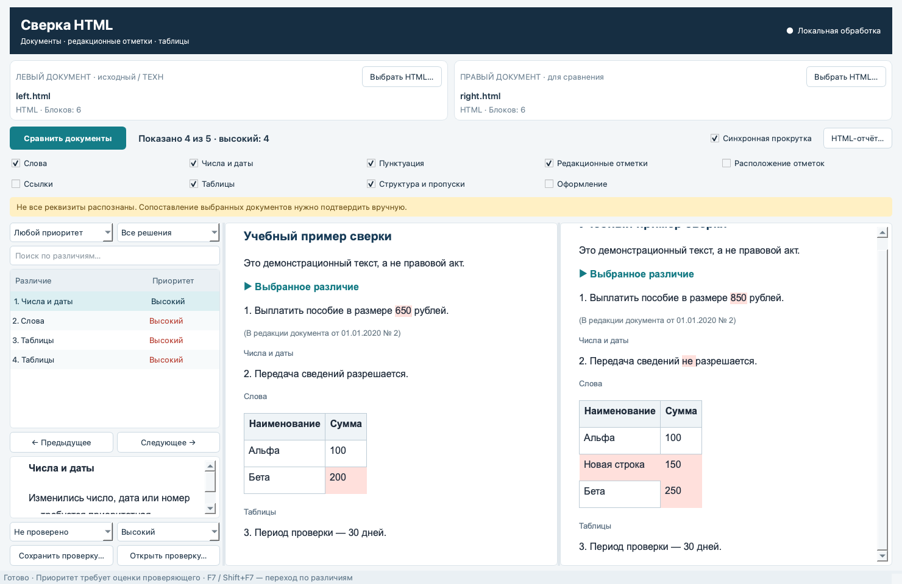

# Сверка HTML

Для сборок без Qt для Windows 7 SP1 и Windows 10/11 см. [инструкцию к нативной версии](native/README.md).

Локальная программа для Windows 10/11 x64: сравнение HTML-документов из ТЕХН / «Комплекс», ГПУ и КонсультантПлюс. Интерфейс на русском языке. Интернет для работы приложения не требуется.



## Запуск в Windows

1. Откройте раздел **Releases** репозитория и скачайте `HTMLCompare-Windows-x64.zip`.
2. Распакуйте **весь архив** в отдельную папку. Сохраните подпапку `_internal` рядом с приложением.
3. Запустите `HTMLCompare.exe`. Python устанавливать не требуется.
4. Выберите два HTML-файла и нажмите **Сравнить документы**.

В папке `examples` есть два учебных файла с различиями в сумме, отрицании и таблице. Исполняемый файл первой версии не подписан цифровым сертификатом.

## Работа с результатом

- Два текста рядом; подсветка изменённых слов и переход по списку различий.
- Фильтры: слова, числа и даты, пунктуация, редакционные отметки, их расположение, ссылки, таблицы, структура, оформление.
- Приоритеты: высокий, средний, низкий. Причина показывается для каждого различия. Приоритет можно изменить вручную.
- Решения: «Не проверено», «Подтверждено», «Допустимо». Файл проверки JSON сохраняет решения и привязывает их к SHA-256 исходных HTML. Для продолжения выберите ту же пару файлов, выполните сверку и откройте JSON.
- HTML-отчёт содержит **все** найденные различия и решения, включая скрытые текущими фильтрами.
- F7 / Shift+F7 — следующее / предыдущее различие.
- При выборе различия оба документа переходят к связанным блокам. Ручная синхронная прокрутка использует относительную позицию.

Цвет — приоритет проверки: красный — высокий, жёлтый — средний, голубой — низкий. Ссылки, оформление и расположение отметок по умолчанию скрыты из списка, доступны через чекбоксы. Сами отметки остаются видимыми в документе.

## Как устроена сверка

HTML разбирается в текстовые блоки, заголовки, подписи, отметки и таблицы. Сопоставление использует точные текстовые опоры и последовательное выравнивание промежутков. Соседние фрагменты редакционной отметки собираются; текст внутри `ed` сохраняется. `27¹)` и `27(1))` распознаются как варианты записи номера с дополнительным индексом. Статус «утратил силу» сохраняется в основном представлении даже при вынесении пояснений в отметки.

Однострочные таблицы с датой/номером или историей изменений распознаются как вёрстка. Содержательные таблицы сравниваются по строкам и координатам ячеек с учётом `rowspan` и `colspan`. Вставленная строка сопоставляется отдельно.

Изменения чисел, дат, отрицаний и отсутствие блоков получают высокий приоритет. Различия реквизитов отметок и дат действия тоже требуют приоритетной проверки. Оценка основана на правилах и **не является юридическим заключением**; её подтверждает специалист.

Система сообщает о разных реквизитах, датах состояния/редакции и списках изменяющих актов. Она не устанавливает самостоятельно юридическую эквивалентность редакций или правильность одного из источников.

## Ограничения первой версии

- Представление восстановлено из содержимого: исходные шрифты, цвета, картинки и точная вёрстка не воспроизводятся. Скрипты и внешние ресурсы не исполняются и не загружаются.
- Смена адреса ссылки выделяется отдельно. Эквивалентность внутренних идентификаторов документов разных компаний автоматически не устанавливается.
- Сложные переносы текста между разделами могут показываться как отсутствие и добавление блоков. Повторяющиеся и полностью переписанные фрагменты требуют ручной проверки.
- Разбор отметок настроен по исследованным образцам ТЕХН, ГПУ и К+. Другие выгрузки могут требовать новых правил. Нераспознанный текст не считается заведомо служебным.
- Нет OCR и сверки текста на изображениях. Для вложенных таблиц выдаётся предупреждение; сложное изменение столбцов требует ручной проверки.
- Ограничения: 50 МБ на файл, 6000 блоков, 100 000 позиций в одной таблице.

## Разработка

Python 3.11–3.12; для релизов используется 3.12.

```sh
python -m venv .venv
# Windows:
.venv\Scripts\activate
# macOS / Linux:
# source .venv/bin/activate
python -m pip install -r requirements.txt
python run.py
python -m unittest discover -s tests -v
```

Проверка запуска без взаимодействия:

```sh
python run.py --smoke-test --left examples/left.html --right examples/right.html
```

Сборка на Windows:

```sh
python -m pip install pyinstaller==6.16.0
python -m PyInstaller --noconfirm --clean --windowed --onedir --name HTMLCompare run.py
```

Windows-сборка выполняется на Windows, а не на macOS. Workflow `.github/workflows/windows.yml` запускает тесты, проверку интерфейса, упаковку и проверку запуска собранного EXE. Пуш тега `v*` публикует архив в Releases. Тестовые исходные документы пользователя в репозиторий не включены; примеры синтетические.

## Зависимости

- [Qt for Python](https://doc.qt.io/qtforpython-6/) / PySide6 Essentials — интерфейс.
- [lxml](https://lxml.de/) — разбор HTML.
- [PyInstaller](https://pyinstaller.org/en/stable/usage.html) — упаковка приложения отдельно для каждой ОС.

Лицензии сторонних компонентов: [THIRD_PARTY_NOTICES.md](THIRD_PARTY_NOTICES.md). Лицензия на собственный код проекта пока не назначена владельцем; открытая лицензия автоматически не предоставляется.
